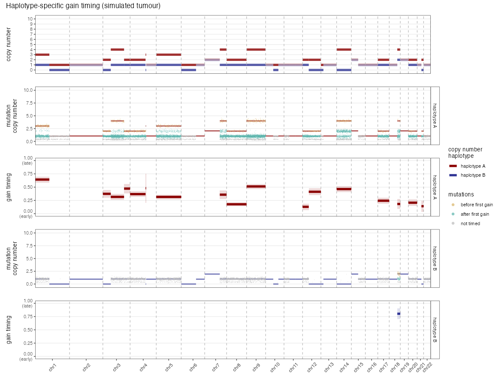

# phaseTime

<!-- badges: start -->
[](LICENSE.md)
<!-- badges: end -->

**Haplotype-specific phasing of somatic mutations and timing of copy number gains, using long-read and short-read whole genome sequencing.**

Cancer genomes often gain extra copies of chromosome segments, and the same segment can be gained several times over a tumour's evolution. phaseTime estimates *when* each of these gains happened, separately for each parental haplotype:

1. **Phase mutations to haplotypes.** Somatic mutations are linked to heterozygous SNPs on the same long sequencing reads. The SNPs are assigned to haplotypes from their B-allele frequencies in regions of allelic imbalance. With multi-region data, one imbalanced region is enough to phase every region.
2. **Time mutations.** A mutation's multiplicity (the number of DNA copies that carry it) shows whether it was acquired before a gain (early) or after it (late). Multiplicities clustering below the observed copy number reveal ancestral copy number states.
3. **Time copy number gains.** The ratio of early mutations to all copy-number-adjusted mutations gives the timing of the first gain and any later gains of a segment. With mutation clusters and a phylogenetic tree, gains are placed on the edge of the tree where they occurred.



*Example phaseTime output for a simulated tumour. From top to bottom: haplotype-specific copy number; haplotype A mutations (yellow: acquired before the first gain, blue: after it); haplotype A gain timing with 95% confidence intervals (0 = early, 1 = late); and the same two panels for haplotype B.*

## Installation

phaseTime requires R (≥ 4.1). Its only dependencies are `ggplot2` and `patchwork`.

```r
# install.packages("remotes")
remotes::install_github("kerstinth/phaseTime", build_vignettes = TRUE)
```

Or from a local clone:

```bash
git clone https://github.com/kerstinth/phaseTime.git
R CMD INSTALL phaseTime
```

## Quick start

```r
library(phaseTime)

# a simulated two-region tumour with known gain timing
sim <- simulate_tumour(seed = 1)

# run the full workflow on all regions
res <- run_phaseTime(sim$mutations, sim$cn, sim$purity, sim$snps, sim$linkage,
                     cluster_col = "cluster", tree = sim$tree)

head(res$timing)   # one row per timed gain: segment, haplotype, cluster, timing, 95% CI

r1 <- res$mutations[res$mutations$sample == "SIM001_R1", ]
plot_phased_mutations(r1, type = "haplotype")                          # mutations coloured by haplotype
plot_gain_timing(res$timing[res$timing$sample == "SIM001_R1", ], r1)   # genome-wide gain timing
plot_timing_heatmap(res$timing)                                        # first gains across regions
```

## Input data

| input | description |
|---|---|
| `mutations` | somatic mutations per sample (`chr`, `pos`, `vaf` or read counts, optionally a mutation `cluster`), e.g. from Mutect2 on short-read WGS |
| `cn` | allele-specific copy number segments per sample, e.g. from Battenberg |
| `purity` | tumour purity per sample |
| `snps` | B-allele frequencies of heterozygous germline SNPs per sample |
| `linkage` | for each mutation and nearby SNP, the number of long reads carrying the mutation together with the SNP's alternative or reference allele |
| `tree` *(optional)* | tumour phylogeny, e.g. a CONIPHER tree object |

Upstream steps (long-read base calling and alignment, mutation and copy number calling, tree building, and counting reads at mutation–SNP pairs) are run outside the package. `select_phasing_snps()` creates the list of mutation–SNP pairs to count.

## Functions

| step | functions |
|---|---|
| Full workflow | `run_phaseTime()` |
| Select SNPs near mutations | `select_phasing_snps()` |
| Phase SNPs (single- and multi-region) | `phase_snps()` |
| Haplotype-specific copy number | `battenberg_average_cn()`, `parse_battenberg_msai()`, `haplotype_copy_number()`, `detect_wgd()` |
| Mutation multiplicity | `annotate_mutations()`, `mutation_multiplicity()` |
| Phase mutations | `phase_mutations()`, `phasing_summary()` |
| Early / late mutations | `classify_mutation_timing()` |
| Ancestral copy number states | `assign_cn_states()` |
| Gain timing | `gain_timing_from_counts()`, `time_gains()`, `compare_region_timing()` |
| Trees | `as_phaseTime_tree()` |
| Plots | `plot_snp_haplotypes()`, `plot_phased_mutations()`, `plot_phasing_summary()`, `plot_mutation_timing()`, `plot_cn_states()`, `plot_gain_timing()`, `plot_timing_heatmap()`, `plot_region_comparison()`, `plot_cluster_segment()`, `plot_timing_tree()` |
| Simulations | `simulate_snp_phasing()`, `simulate_gain_history()`, `simulated_gain_timing()`, `simulate_gain_timing_accuracy()`, `simulate_tumour()`, `detection_limit_cn()` |

Every function is documented, e.g. `?time_gains`.

## Tutorial

The tutorial walks through every step of the method on a simulated tumour, with illustrations of the principles and example output from real lung tumour data:

- in R: `vignette("phaseTime")`
- rendered: [docs/phaseTime_tutorial.html](https://kerstinth.github.io/phaseTime/phaseTime_tutorial.html)

## Method and citation

phaseTime implements the methods of **Chapter 6** (*Haplotype specific somatic copy number gain timing using long-read sequencing of lung tumours*) and **Section 2.2.3** of my PhD thesis, which also describes the validation by simulation and an application to the TRACERx long-read cohort:

> Thol, K. M. (2024). *Harnessing Whole Genome Sequencing Technologies to Elucidate Lung Cancer Evolution* [Doctoral thesis, University College London]. UCL Discovery. https://discovery.ucl.ac.uk/id/eprint/10203820/

If you use phaseTime, please cite the thesis.

## Notes

- By default, mutation counts are divided by the number of DNA copies present when the mutations were acquired (thesis Section 6.3.5.2, Figure 6-13). `adjust = "multiplicity"` in `time_gains()` reproduces the original analysis script, which divided by the multiplicity of each copy number state.
- The original analysis scripts are kept in [`legacy/`](legacy/). They are not part of the installed package.

## License

MIT © Kerstin Thol
